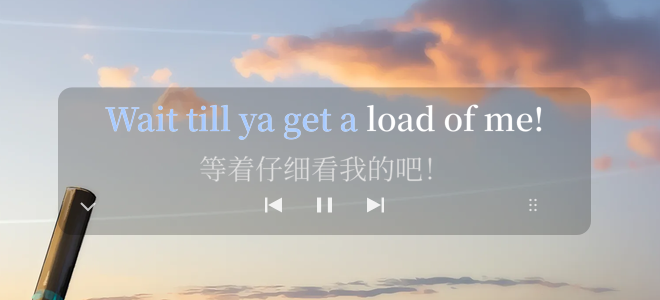
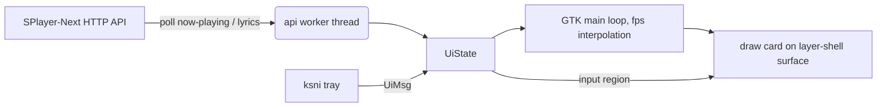

# splayer-lyrics

[简体中文](README.md) | **English**

[](LICENSE)

[](https://github.com/YaLTeR/niri)


A desktop lyrics overlay for [**SPlayer-Next**](https://github.com/SPlayer-Dev/SPlayer-Next) on **niri / Wayland**, written in
Rust with GTK4 and gtk4-layer-shell.

It draws a draggable translucent card above normal windows and fullscreen apps,
with word-by-word karaoke fill, translation, playback controls, a tray menu and
automatic show/hide.

Repository: <https://github.com/wangoutlook/splayer-lyrics>



## Contents

- [Features](#features)
- [Requirements](#requirements)
- [Installation](#installation)
- [Usage](#usage)
- [Autostart](#autostart-niri)
- [Configuration](#configuration)
- [Runtime files](#runtime-files)
- [How it works](#how-it-works)
- [Performance](#performance)
- [Troubleshooting](#troubleshooting)
- [Known limitations](#known-limitations)
- [Roadmap](#roadmap)
- [Contributing](#contributing)
- [Acknowledgements](#acknowledgements)
- [License](#license)

## Features

- **Word-by-word lyrics** driven by SPlayer-Next's timing, with an optional
  translation line.
- **Visible only while needed**: when SPlayer-Next is closed or its API is
  unreachable, the card, shadow and controls are not drawn at all and the
  surface has an empty input region.
- **Draggable**: drag the controls or the six-dot handle; the position is saved.
  A control click fires only on release when the drag threshold was not
  crossed, so dragging a control never toggles playback.
- **Configurable width growth**: when a lyric line gets longer or shorter, the
  card can grow symmetrically, to the left (right edge fixed) or to the right
  (left edge fixed). Switchable from the tray.
- **Tray menu** (StatusNotifierItem): font size, font family, width growth,
  translation/romanization toggles, lyric offset, color preset, monitor
  selection, show/hide and quit.
- **Hide button** at the card's bottom-left.
- **Theme accent sync**: can read the current niri / Waybar accent color and
  follow it every 5 seconds.
- **Low idle cost**: about 22 MB PSS / 0.2% of one CPU core when the player is
  closed.
- **Fullscreen friendly**: uses the layer-shell `overlay` layer.
- **Click-through lyrics**: only the hide button, the three controls and the
  drag handle accept pointer input.

## Requirements

| Dependency | Notes |
|---|---|
| Linux + Wayland | Fully tested on niri; other layer-shell compositors may work |
| GTK 4.10+ | Rendering and windowing |
| gtk4-layer-shell | Transparent layer surface above other windows |
| Rust / Cargo | Build |
| Waybar (optional) | The tray menu needs Waybar's `tray` module |
| SPlayer-Next | External API enabled, default `127.0.0.1:14558` |
| Fonts | Defaults to `Noto Sans, Noto Sans CJK SC`; `LXGW WenKai Screen` optional |

On Arch Linux:

```sh
sudo pacman -S --needed gtk4 gtk4-layer-shell rust pkgconf
```

On other distributions install the GTK4 development package, the
gtk4-layer-shell development package, pkg-config and Rust. Check the
layer-shell development files with:

```sh
pkg-config --exists gtk4-layer-shell-0 && echo ok
```

## Installation

```sh
git clone https://github.com/wangoutlook/splayer-lyrics.git
cd splayer-lyrics
./build.sh
```

`build.sh` runs `cargo build --release`; the binary is
`target/release/splayer-lyrics`.

### Enable the SPlayer-Next API

Enable the external API in SPlayer-Next's settings (the exact location varies by
version). Verify it:

```sh
curl -fsS http://127.0.0.1:14558/api/info
# {"name":"SPlayer-Next","version":"...","wsClients":0}
```

If you changed the port, update `api.port` in `config.json`.

### Run

```sh
./start.sh     # detached start, writes runtime/pid, logs to runtime/run.log
./status.sh    # PID, RSS/PSS, API reachability, niri layer namespaces
./stop.sh      # SIGTERM to the pid in runtime/pid
```

`start.sh` exports `GDK_BACKEND=wayland GSK_RENDERER=cairo GTK_A11Y=none
NO_AT_BRIDGE=1 GTK_THEME=Adwaita`. The cairo renderer uses much less memory than
GL. To compare:

```sh
SPLAYER_LYRICS_GSK_RENDERER=gl ./start.sh
```

You can also run the binary directly:

```sh
./target/release/splayer-lyrics --config config.json
./target/release/splayer-lyrics --config config.json --debug
```

`--config` defaults to `./config.json`; `--debug` mirrors debug logs to stderr
(which `start.sh` also appends to `runtime/run.log`).

## Usage

### Drag

- Drag the centered prev / play-pause / next buttons, or the six-dot handle at
  the bottom-right.
- The position is saved to `runtime/position.json` on release.
- The card width follows the current lyric line, anchored at the saved
  horizontal center.
- Only the card coordinates change; the full-output surface itself never moves,
  so dragging stays 1:1 with the pointer.

### Width growth direction

When a lyric line gets wider or narrower, the anchor is controlled by
`width_mode` (or the tray's “宽度变化” submenu):

- `center` (default): the center stays fixed; the card grows/shrinks both ways;
- `left`: the right edge stays fixed; the card grows towards the left;
- `right`: the left edge stays fixed; the card grows towards the right.

The setting applies on the next lyric-line width change; switching it does not
jump the card. `runtime/position.json` stores both the center and the width, so
the last layout is restored after a restart.

### Hide

- The `⌄` button at the card's bottom-left hides the whole card and clears the
  input region.
- The tray item “显示/隐藏歌词” shows it again.
- Visibility is stored in `runtime/ui.json` and survives restarts.

### Tray menu

| Item | Action |
|---|---|
| 显示/隐藏歌词 | Toggle the whole card |
| 显示翻译 / 显示罗马音 | Toggle the translation / romanization line |
| 字号 | 28 / 32 / 36 / 40 px |
| 字体 | Noto Sans + CJK, Noto Sans CJK, LXGW WenKai Screen, Noto Serif CJK |
| 宽度变化 | Symmetric (center), grow left (right edge fixed), grow right (left edge fixed) |
| 歌词偏移 | Nudge the current offset by -100 / -50 / +50 / +100 ms, or reset to 0 (range ±30 s) |
| 显示器 | Current GDK monitors; refreshed after an automatic hotplug restart |
| 配色 | Follow system accent, SPlayer pink, white, blue, green |
| 退出 | Quit the overlay |

Font size, family, color, visibility, width mode, translation/romanization
toggles and lyric offset are stored in `runtime/ui.json` and take precedence
over `config.json`. The tray is a StatusNotifierItem, so Waybar's `tray` module
must be enabled.

### Monitor selection

On startup the overlay picks an output in this order:

1. `last_output` in `runtime/ui.json` (the screen it was last placed on);
2. if that screen is gone, `output` in `config.json` (the first-run seed);
3. otherwise the connected monitor with the highest resolution; the earliest
   entry wins ties.

Set `output` in `config.json` to `auto` to skip step 2 (`last_output` still wins).

Plugging or unplugging a monitor, or changing a resolution, waits 350 ms for the
layout to settle, saves the position and restarts the overlay (about one second
of flicker). The restart runs the selection above again, and the new monitor
appears in the tray menu. Choosing a monitor from the tray rewrites `output` in
`config.json`, records the choice in `ui.json`, and restarts.

The card is placed on the selected output only. It does **not** drag across
outputs because a layer-shell surface is bound to a single output. Drag the card
back if it ends up partly off-screen.

### Theme accent

“Follow system accent” reads, in order:

1. `active-gradient from="..."` or `active-color` in
   `~/.config/niri/colors.kdl`;
2. an `@define-color` containing `accent` in `~/.config/waybar/colors.css`.

If the desktop theme changes dynamically (for example DMS), the lyrics color
follows every 5 seconds. Pick a fixed color preset in the tray to stop that.

### Auto show/hide and click-through

- When the player is closed or the API is unreachable, nothing is drawn and the
  input region is empty.
- When the player returns, the card reappears unless it was hidden manually.
- The lyric area is always click-through; only the hide button, the three
  controls and the drag handle are interactive.

## Autostart (niri)

Add this to `~/.config/niri/config.kdl` (adjust the path):

```kdl
// SPlayer-Next desktop lyrics (hidden while the player is closed)
spawn-sh-at-startup "sleep 2; cd ~/repo/splayer-lyrics && ./start.sh"
```

- The 2-second delay lets Waybar's tray watcher start first.
- `spawn-at-startup` is only read when niri starts; log out/in, or run
  `./start.sh` once manually.
- Back up and validate after editing:

```sh
cp ~/.config/niri/config.kdl ~/.config/niri/config.kdl.bak
niri validate
```

If the player is not running, the overlay process still starts but draws
nothing; it keeps the tray icon and costs about 22 MB PSS / 0.2% CPU.

## Configuration

All keys in `config.json` are optional; missing keys use these defaults:

```json
{
  "api": {"host": "127.0.0.1", "port": 14558, "poll_ms": 900},
  "output": "HDMI-A-1",
  "width_mode": "center",
  "width": 1800,
  "height": 200,
  "bottom_margin": 96,
  "position_file": "runtime/position.json",
  "font_family": "Noto Sans, Noto Sans CJK SC",
  "font_size": 36,
  "font_weight": 600,
  "supersample": 2.0,
  "played_color": "#fe7971",
  "unplayed_color": "#ffffff",
  "translation_color": "#d8d8d8",
  "translation_size_delta": 4,
  "show_translation": true,
  "show_romanization": false,
  "word_by_word": true,
  "fps": 20,
  "lyric_offset_ms": 0,
  "hide_when_disconnected": true,
  "background": {
    "enabled": true,
    "color": "#000000",
    "alpha": 0.22,
    "radius": 14,
    "padding_x": 28,
    "padding_y": 12
  },
  "controls": {
    "enabled": true,
    "right_margin": 48,
    "bottom_margin": 24,
    "size": 44,
    "opacity": 0.85
  }
}
```

| Key | Default | Description |
|---|---|---|
| `api.host` / `api.port` | `127.0.0.1` / `14558` | SPlayer-Next API address |
| `api.poll_ms` | `900` | Poll interval in milliseconds |
| `output` | `HDMI-A-1` | First-run monitor seed; afterwards `last_output` in `runtime/ui.json` wins, then the highest-resolution screen |
| `width_mode` | `center` | Width growth: `center` symmetric, `left` right edge fixed, `right` left edge fixed |
| `width` | `1800` | Fallback card width; the real width is measured per line |
| `height` | `200` | Fixed card height |
| `bottom_margin` | `96` | Default distance from the bottom when no position file exists |
| `position_file` | `runtime/position.json` | Saved card position |
| `font_family` | `Noto Sans, Noto Sans CJK SC` | Default font; tray choice overrides |
| `font_size` | `36` | Default size; tray choice overrides |
| `font_weight` | `600` | Main lyric weight |
| `supersample` | `2.0` | Text supersampling, 1.0–3.0; lower is cheaper |
| `played_color` | `#fe7971` | Played text color |
| `unplayed_color` | `#ffffff` | Unplayed text color |
| `translation_color` | `#d8d8d8` | Translation color |
| `translation_size_delta` | `4` | Translation is this many px smaller |
| `show_translation` | `true` | Show the translation line |
| `show_romanization` | `false` | Show romanization |
| `word_by_word` | `true` | Fill word by word; otherwise color the whole line |
| `fps` | `20` | Local interpolation rate while playing, max 30 |
| `lyric_offset_ms` | `0` | Extra lyric delay (positive delays) |
| `hide_when_disconnected` | `true` | Hide the whole card when the API is down |
| `background.enabled` | `true` | Draw the shared rounded shadow |
| `background.color` | `#000000` | Shadow color |
| `background.alpha` | `0.22` | Shadow opacity |
| `background.radius` | `14` | Corner radius |
| `background.padding_x` / `padding_y` | `28` / `12` | Card padding; the horizontal value participates in width measurement, the vertical value pads the background |
| `controls.enabled` | `true` | Show the bottom controls |
| `controls.right_margin` | `48` | Handle distance from the card's right edge |
| `controls.bottom_margin` | `24` | Controls distance from the card's bottom |
| `controls.size` | `44` | Control button size |
| `controls.opacity` | `0.85` | Control icon opacity |

Notes:

- `width` is only a fallback; the real width is measured from the line,
  translation and controls, then clamped to the monitor.
- `supersample=2.0` looks smoother but spikes CPU on line changes; 1.0–1.5 is
  cheaper.
- To lower CPU further, use `fps=15` or `word_by_word=false`; to lower visual
  work, disable `background` or `show_translation`.
- `GSK_RENDERER=cairo` and `GTK_A11Y=none` matter; the GL renderer roughly
  doubles PSS.
- Tray choices are stored in `runtime/ui.json`; after that, changing
  font/size/color/width mode/translation toggles/lyric offset in `config.json`
  will not override them. Delete `runtime/ui.json` to fall back to the config
  file.

## Runtime files

| File | Description |
|---|---|
| `runtime/pid` | Current process PID |
| `runtime/run.log` | Append-only timestamped log; `start.sh` rotates it to `run.log.1` at startup if above 5 MB |
| `runtime/position.json` | Card center, width and bottom distance |
| `runtime/ui.json` | Tray settings: visibility, font, size, color, follow-system, width mode, translation/romanization, lyric offset, last monitor |
| `runtime/*.png` | Test screenshots (not used at runtime) |

All of these are ignored by `.gitignore`.

## How it works



- A worker thread polls `GET /api/now-playing` every `api.poll_ms` with 1.5 s
  timeouts.
- Each poll computes
  `position + clamp(local_now_ms - sendTimestamp, 0, 5000) * speed` as the
  reported time and re-anchors only when it differs from the local prediction
  by more than 120 ms; smaller differences keep the local clock to avoid
  polling jitter. Between polls the GTK main loop interpolates at `fps`.
- Lyrics are fetched when the track changes, or when `lyricAvailable` is true
  but no lines are loaded. Responses with a different `trackId` are dropped.
- Without lyrics, the overlay shows the track title and artists; it switches to
  the lyric line as soon as `/api/lyrics` returns.
- The full line is laid out once with Pango; word x-ranges come from byte
  indexes. The played part is drawn by clipping rectangles and drawing the same
  layout again in the played color.
- The card lives inside a fixed full-output transparent layer-shell surface.
  Dragging changes card coordinates, not the surface.
- The input region contains only the hide button, the three controls and the
  handle; the lyric area is click-through.
- Controls POST to `/api/prev`, `/api/play`, `/api/pause`, `/api/next`, then
  resync 180 ms later.
- The tray uses `ksni`'s blocking StatusNotifierItem implementation.

### Design trade-offs

- **Fixed fullscreen surface instead of a moving small window**: stable drag
  feedback and no position jump when entering fullscreen; costs more memory and
  compositing.
- **Cairo by default**: much less memory than GL; the drawing load is small.
- **2× supersampled text**: laid out and cached once per line, so CPU spikes
  only on line changes.
- **One output at a time**: true cross-monitor drag needs per-output surfaces and
  global coordinates, which is significantly more complex; hotplug and mode
  changes are covered by an automatic restart.
- **HTTP polling only**: no WebSocket/MPRIS dependency; also works against a
  remote host.

## Performance

Measured on this machine (niri, HDMI-A-1 2560×1440, `fps=20`,
`GSK_RENDERER=cairo`, `supersample=2.0`, 32 px Noto Serif CJK):

| State | RSS | PSS | CPU (one core) |
|---|---:|---:|---:|
| Playing, lyrics visible | ~88–96 MB | ~42–50 MB | ~5–7% |
| Paused, player open | ~88 MB | ~42 MB | ~0.4% |
| SPlayer closed / API down (nothing drawn) | ~62 MB | ~22 MB | ~0.2% |

The full-output transparent surface and the 2× text cache dominate memory; line
changes cause short CPU spikes. `supersample=1.5` lowers PSS noticeably with
slightly softer text.

The release binary is about 7.4 MB (the tray pulls in zbus). These numbers cover
the overlay process only, not SPlayer-Next.

## Troubleshooting

### No tray icon

- Make sure Waybar has the `"tray"` module and restart Waybar.
- Check D-Bus:

```sh
busctl --user list | grep -i StatusNotifierItem
```

- If the overlay started before Waybar, restart it:

```sh
./stop.sh && ./start.sh
```

### No lyrics / always hidden

```sh
curl -fsS http://127.0.0.1:14558/api/info
curl -fsS http://127.0.0.1:14558/api/now-playing
```

- Confirm the external API is enabled in SPlayer-Next.
- Confirm `api.port` matches the player.
- Look for `API unreachable` or `lyrics fetch failed` in
  `runtime/run.log`.

### Controls do not react

- The lyric area is click-through by design; only the hide button, the controls
  and the handle are interactive.
- niri may remap the layer surface when entering fullscreen; the app re-applies
  the input region every second. Restart the overlay if it still fails.

### Wrong position after switching monitors

- The card may extend slightly off-screen to keep the handle visible; drag it
  back.
- Or delete `runtime/position.json` to start from the default bottom-center
  position.

### Startup fails

```sh
tail -50 runtime/run.log
```

Common causes: missing `gtk4-layer-shell`, not running under Wayland, or a wrong
monitor connector name (the overlay falls back to the highest-resolution screen;
look for `selected monitor` in `runtime/run.log`).

## Known limitations

- One output at a time; the tray can switch monitors but the card cannot be
  dragged across the screen boundary. Hotplug or a resolution change restarts
  the overlay (about one second).
- Wayland only; no X11, Windows or macOS build.
- Only SPlayer-Next's HTTP API is supported.
- The tray needs a StatusNotifierWatcher (Waybar); without it the app still runs
  but only the config file can be used.
- No per-word translation or duet positioning.
- No built-in hotkeys; autostart must be added to the niri config manually.
- The autostart example targets niri; no systemd user unit is provided.
- Theme-accent sync polls every 5 seconds; a dynamic theme makes the lyric color
  change as well.

## Roadmap

- [x] Word-by-word lyrics, translation, playback controls
- [x] Shared shadow, hide button, click-through lyrics
- [x] StatusNotifierItem tray menu
- [x] Font size / family / color / show-hide / quit
- [x] Translation/romanization toggles and lyric offset in the tray
- [x] Follow niri / Waybar accent color
- [x] Monitor switch from the tray (enumerated dynamically)
- [x] Draw nothing while the player is closed
- [x] Configurable width growth (symmetric / left / right)
- [ ] True cross-monitor dragging (one surface per output + global coordinates)
- [ ] Custom hotkeys
- [ ] systemd user service / a more generic autostart story
- [ ] Support more players
- [ ] Per-word translation / duet layout

## Contributing

Issues and pull requests are welcome.

```sh
cargo fmt
cargo test --release
cargo build --release
```

Before submitting:

- `cargo test --release` passes;
- `runtime/`, `target/`, `backups/` and personal screenshots are not committed;
- behavior changes update the README and `config.json` defaults.

## Acknowledgements

- [SPlayer-Next](https://github.com/SPlayer-Dev/SPlayer-Next) for playback and the lyrics API;
- [gtk4-rs](https://github.com/gtk-rs/gtk4-rs) and
  [gtk4-layer-shell](https://github.com/wmww/gtk4-layer-shell) for GTK/Wayland;
- [ksni](https://github.com/iovxw/ksni) for StatusNotifierItem;
- Pango and Cairo for text layout and drawing.

## License

[MIT License](LICENSE), Copyright © 2026 Xianghe Wang.
