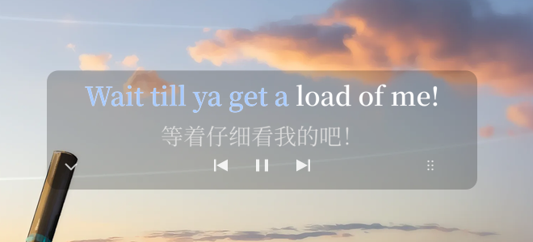
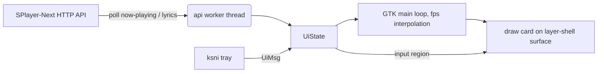

# splayer-lyrics

[English](README.en.md) | **简体中文**

[](LICENSE)

[](https://github.com/YaLTeR/niri)


面向 [**SPlayer-Next**](https://github.com/SPlayer-Dev/SPlayer-Next) 的桌面歌词覆盖层，使用 Rust + GTK4 + gtk4-layer-shell，
为 **niri / Wayland** 设计。

歌词以一张可拖动的半透明卡片显示在播放器窗口和全屏应用之上，支持逐字卡拉 OK
填充、翻译、播放控制、托盘菜单和自动显隐。

项目地址：<https://github.com/wangoutlook/splayer-lyrics>



## 目录

- [功能](#功能)
- [环境要求](#环境要求)
- [安装](#安装)
- [使用](#使用)
- [开机自启](#开机自启niri)
- [配置](#配置)
- [运行时文件](#运行时文件)
- [工作原理](#工作原理)
- [性能](#性能)
- [排错](#排错)
- [已知限制](#已知限制)
- [Roadmap](#roadmap)
- [贡献](#贡献)
- [致谢](#致谢)
- [许可证](#许可证)

## 功能

- **逐字歌词**：按 SPlayer-Next 的逐字时间轴填充已播放部分，支持翻译行。
- **自动显隐**：只在 SPlayer-Next 运行时显示；播放器关闭或 API 不可达时，卡片、
  阴影和控件全部不绘制，屏幕不残留任何东西。
- **可拖动**：拖动控制按钮或右下角六点手柄移动卡片，位置自动保存。
- **卡片伸缩方向**：歌词变长时可选对称伸缩、向左伸缩（右边缘不动）或向右伸缩
  （左边缘不动），可在托盘切换。
- **托盘控制栏**：字号、字体、宽度变化、翻译/罗马音开关、歌词偏移、配色、
  显示器切换、显示/隐藏、退出。
- **左下角隐藏按钮**：一键收起整张卡片，之后可从托盘重新显示。
- **主题色同步**：可从 niri / Waybar 配置读取当前强调色，并每 5 秒跟随变化。
- **低占用**：播放器关闭时约 22 MB PSS / 0.2% 单核 CPU。
- **全屏友好**：使用 layer-shell 的 `overlay` 层，全屏游戏/视频上仍可显示。
- **点击穿透**：只有控制按钮、隐藏按钮和拖动手柄接收鼠标事件。

## 环境要求

| 依赖 | 说明 |
|---|---|
| Linux + Wayland | 只在 niri 上完整测试；其他 layer-shell 合成器理论可用 |
| GTK 4.10+ | 绘制与窗口 |
| gtk4-layer-shell | 覆盖在其他窗口之上的透明 layer surface |
| Rust / Cargo | 构建 |
| Waybar（可选） | 托盘菜单需要 Waybar 的 `tray` 模块 |
| SPlayer-Next | 需要开启外部 API，默认 `127.0.0.1:14558` |
| 字体 | 默认 `Noto Sans, Noto Sans CJK SC`；可选 `LXGW WenKai Screen` |

Arch Linux：

```sh
sudo pacman -S --needed gtk4 gtk4-layer-shell rust pkgconf
```

其他发行区请安装对应的 GTK4 开发包、gtk4-layer-shell 开发包、pkg-config 和 Rust。
可以用下面的命令确认 layer-shell 开发文件存在：

```sh
pkg-config --exists gtk4-layer-shell-0 && echo ok
```

## 安装

```sh
git clone https://github.com/wangoutlook/splayer-lyrics.git
cd splayer-lyrics
./build.sh
```

`build.sh` 等价于 `cargo build --release`，产物在
`target/release/splayer-lyrics`。

### 配置 SPlayer-Next

在 SPlayer-Next 设置中开启外部 API（不同版本位置可能不同，通常在“网络与服务”
或“集成”相关页面）。确认接口可用：

```sh
curl -fsS http://127.0.0.1:14558/api/info
# {"name":"SPlayer-Next","version":"...","wsClients":0}
```

如果端口被修改，同步修改 `config.json` 的 `api.port`。

### 启动

```sh
./start.sh     # 后台启动，写入 runtime/pid，日志追加到 runtime/run.log
./status.sh    # PID、RSS/PSS、API 连通性、niri layer namespace
./stop.sh      # 按 runtime/pid 发送 SIGTERM
```

`start.sh` 会设置：

```sh
GDK_BACKEND=wayland
GSK_RENDERER=cairo
GTK_A11Y=none
NO_AT_BRIDGE=1
GTK_THEME=Adwaita
```

默认使用 cairo 渲染器，内存明显低于 GL。想对比 GL 渲染器：

```sh
SPLAYER_LYRICS_GSK_RENDERER=gl ./start.sh
```

也可以直接运行二进制：

```sh
./target/release/splayer-lyrics --config config.json
./target/release/splayer-lyrics --config config.json --debug
```

`--config` 默认是当前目录下的 `config.json`；`--debug` 会把调试日志同时输出到
stderr。`start.sh` 会把 stderr 重定向到 `runtime/run.log`。

## 使用

### 拖动

- 按住底部居中的上一首 / 播放暂停 / 下一首，或右下角六点手柄拖动。
- 按下后超过系统拖动阈值才进入拖动，因此拖动控制按钮不会误触播放/暂停。
- 松开后位置保存到 `runtime/position.json`，下次启动恢复。
- 卡片宽度会随歌词长度变化，但始终以保存的水平中心为锚点。
- 拖动只改变卡片在固定全屏 surface 内的坐标，指针跟手，不会和合成器的窗口
  移动反馈打架。

### 卡片伸缩方向

歌词行变长或变短时，卡片宽度的锚点由 `width_mode`（或托盘“宽度变化”）决定：

- `center`（默认）：中心不动，左右对称伸缩；
- `left`：右边缘固定，变宽时向左扩展，变窄时向右收缩；
- `right`：左边缘固定，变宽时向右扩展，变窄时向左收缩。

托盘切换后立即生效，下一次歌词行宽度变化时按新方向布局，当前卡片不会瞬移。
`runtime/position.json` 同时保存卡片中心和宽度，重启后可以恢复上次布局。

### 隐藏

- 卡片左下角的 `⌄` 按钮：隐藏整张卡片，并清空输入区域。
- 托盘菜单“显示/隐藏歌词”：重新显示或再次隐藏。
- 隐藏状态保存在 `runtime/ui.json`，重启后保持。

### 托盘菜单

| 菜单 | 作用 |
|---|---|
| 显示/隐藏歌词 | 切换整张卡片的可见性 |
| 显示翻译 / 显示罗马音 | 切换对应副行 |
| 字号 | 28 / 32 / 36 / 40 px |
| 字体 | Noto Sans + CJK、Noto Sans CJK、霞鹜文楷 Screen、Noto Serif CJK |
| 宽度变化 | 对称伸缩（中心不动）、向左伸缩（右边缘不动）、向右伸缩（左边缘不动） |
| 歌词偏移 | 在当前值上 -100 / -50 / +50 / +100 ms，或重置为 0（范围 ±30 s） |
| 显示器 | 枚举当前 GDK monitor；插拔后自动重启并刷新 |
| 配色 | 跟随系统主题色、SPlayer 粉、白、蓝、绿 |
| 退出 | 结束覆盖层进程 |

字号、字体、颜色、可见性、宽度模式、翻译/罗马音开关和歌词偏移保存在
`runtime/ui.json`，优先于 `config.json` 中的默认值。托盘是
StatusNotifierItem，需要 Waybar 的 `tray` 模块。

### 显示器选择

覆盖层启动时按以下顺序选屏：

1. `runtime/ui.json` 里的 `last_output`（上次所在的屏）；
2. 上次的屏已不在时，用 `config.json` 的 `output`（仅作为首次启动的种子）；
3. 两者都不可用时，选**当前分辨率最高**的显示器；面积相同取枚举顺序靠前的。

把 `config.json` 的 `output` 设为 `auto` 可以跳过上面的第 2 步（`last_output` 仍然优先）。

插拔显示器或改变分辨率时，程序等待 350 ms 让布局稳定，然后保存位置并自动重启
（约 1 秒闪断）。重启后重新按上面的顺序选屏，新插入的显示器也会出现在托盘菜单
里。从托盘选择会改写 `config.json` 的 `output`、把选择记进 `ui.json`，然后重启。

只是把卡片放到目标屏幕，**不支持拖过屏幕边界**；layer-shell surface 绑定在单个
输出上。切换后如果卡片偏出屏幕，直接拖回来即可；位置文件仍保存原来的相对位置。

### 主题色

“跟随系统主题色”按以下顺序读取：

1. `~/.config/niri/colors.kdl` 里的 `active-gradient from="..."` 或 `active-color`；
2. `~/.config/waybar/colors.css` 里包含 `accent` 的 `@define-color`。

如果主题色会随壁纸动态变化（例如 DMS），歌词颜色也会每 5 秒跟着变；想固定颜色
就在托盘“配色”里选一个固定项。

### 自动显隐与点击穿透

- 播放器关闭或 API 不可达时，整张卡片（含阴影和控制）不绘制，输入区域为空。
- 播放器重新启动后，如果之前没有被手动隐藏，卡片自动恢复。
- 歌词区域始终点击穿透；只有左下隐藏按钮、底部三个控制和右下六点手柄可交互。

## 开机自启（niri）

在 `~/.config/niri/config.kdl` 中加入（把路径换成你的实际路径）：

```kdl
// SPlayer-Next 桌面歌词（播放器未运行时自动隐藏，托盘可控制）
spawn-sh-at-startup "sleep 2; cd ~/repo/splayer-lyrics && ./start.sh"
```

- `sleep 2` 是为了等 Waybar 的托盘 watcher 就绪。
- `spawn-at-startup` 只在 niri 启动时读取；改完后重新登录，或手动执行一次
  `./start.sh`。
- 修改前建议备份并校验：

```sh
cp ~/.config/niri/config.kdl ~/.config/niri/config.kdl.bak
niri validate
```

如果播放器没有运行，覆盖层进程仍会启动，但卡片完全不绘制，只保留托盘图标；
实测约为 22 MB PSS / 0.2% CPU。

## 配置

`config.json` 中所有键都可省略，省略时使用下面的默认值：

```json
{
  "api": {"host": "127.0.0.1", "port": 14558, "poll_ms": 900},
  "output": "HDMI-A-1",
  "width_mode": "center",
  "width": 1800,
  "height": 200,
  "bottom_margin": 96,
  "position_file": "runtime/position.json",
  "font_family": "Noto Sans, Noto Sans CJK SC",
  "font_size": 36,
  "font_weight": 600,
  "supersample": 2.0,
  "played_color": "#fe7971",
  "unplayed_color": "#ffffff",
  "translation_color": "#d8d8d8",
  "translation_size_delta": 4,
  "show_translation": true,
  "show_romanization": false,
  "word_by_word": true,
  "fps": 20,
  "lyric_offset_ms": 0,
  "hide_when_disconnected": true,
  "background": {
    "enabled": true,
    "color": "#000000",
    "alpha": 0.22,
    "radius": 14,
    "padding_x": 28,
    "padding_y": 12
  },
  "controls": {
    "enabled": true,
    "right_margin": 48,
    "bottom_margin": 24,
    "size": 44,
    "opacity": 0.85
  }
}
```

| 键 | 默认值 | 说明 |
|---|---|---|
| `api.host` / `api.port` | `127.0.0.1` / `14558` | SPlayer-Next 外部 API 地址 |
| `api.poll_ms` | `900` | 轮询间隔（毫秒） |
| `output` | `HDMI-A-1` | 首次启动的显示器种子；之后优先用 `runtime/ui.json` 的 `last_output`，都不可用时选分辨率最高的屏 |
| `width_mode` | `center` | 宽度变化方向：`center` 对称、`left` 右边缘固定、`right` 左边缘固定 |
| `width` | `1800` | 初始/回退卡片宽度；实际宽度按歌词动态测量 |
| `height` | `200` | 卡片固定高度 |
| `bottom_margin` | `96` | 没有位置文件时距屏幕底部的距离 |
| `position_file` | `runtime/position.json` | 卡片位置文件 |
| `font_family` | `Noto Sans, Noto Sans CJK SC` | 默认字体；托盘选择会覆盖 |
| `font_size` | `36` | 默认字号；托盘选择会覆盖 |
| `font_weight` | `600` | 主歌词字重 |
| `supersample` | `2.0` | 文字超采样倍率，1.0–3.0；越低越省 CPU |
| `played_color` | `#fe7971` | 已播放文字颜色 |
| `unplayed_color` | `#ffffff` | 未播放文字颜色 |
| `translation_color` | `#d8d8d8` | 翻译行颜色 |
| `translation_size_delta` | `4` | 翻译行比主歌词小多少像素 |
| `show_translation` | `true` | 是否显示翻译 |
| `show_romanization` | `false` | 是否显示音译/罗马音 |
| `word_by_word` | `true` | 是否逐字填充；关闭后整行变色 |
| `fps` | `20` | 播放时的本地插值帧率，最高 30 |
| `lyric_offset_ms` | `0` | 额外歌词延迟（正数延后） |
| `hide_when_disconnected` | `true` | API 不可达时隐藏整张卡片 |
| `background.enabled` | `true` | 是否绘制共享圆角阴影 |
| `background.color` | `#000000` | 阴影颜色 |
| `background.alpha` | `0.22` | 阴影不透明度，越低越透明 |
| `background.radius` | `14` | 圆角半径 |
| `background.padding_x` / `padding_y` | `28` / `12` | 卡片内边距；水平值参与宽度测量，垂直值为背景上下留白 |
| `controls.enabled` | `true` | 是否显示底部控制 |
| `controls.right_margin` | `48` | 六点手柄距卡片右边缘的距离 |
| `controls.bottom_margin` | `24` | 控制区距卡片底部的距离 |
| `controls.size` | `44` | 控制按钮尺寸 |
| `controls.opacity` | `0.85` | 控制图标不透明度 |

补充说明：

- `width` 只是回退值；实际宽度由当前歌词 + 翻译 + 控件宽度决定，并限制在显示器内。
- `supersample` 为 2.0 时文字更平滑，但换行瞬间 CPU 峰值更高；1.0–1.5 更省资源。
- 想进一步降低 CPU：把 `fps` 调到 15，或关闭 `word_by_word`；降低视觉开销可以关闭
  `background` 或 `show_translation`。
- 内存主要由 GTK/Pango 和全屏透明 surface 占据。`GSK_RENDERER=cairo` 和
  `GTK_A11Y=none` 很重要，GL 渲染器大约会让 PSS 翻倍。
- 托盘选择会写入 `runtime/ui.json`，之后改 `config.json` 里的字体/字号/颜色/
  宽度模式/翻译开关/歌词偏移不会覆盖已保存的托盘选择；删除 `runtime/ui.json`
  可恢复配置文件默认值。

## 运行时文件

| 文件 | 说明 |
|---|---|
| `runtime/pid` | 当前进程 PID |
| `runtime/run.log` | 追加式、带时间戳的运行日志；`start.sh` 启动时若超过 5 MB 轮转为 `run.log.1` |
| `runtime/position.json` | 卡片水平中心、宽度与距底部距离 |
| `runtime/ui.json` | 托盘设置：可见性、字号、字体、颜色、主题色跟随、宽度模式、翻译/罗马音、歌词偏移、上次所在的显示器 |
| `runtime/*.png` | 测试截图（不参与运行） |

这些文件全部被 `.gitignore` 忽略，不会进入仓库。

## 工作原理



- 后台线程每 `api.poll_ms` 轮询一次 `GET /api/now-playing`，超时 1.5 秒。
- 每次轮询计算 `position + clamp(local_now_ms - sendTimestamp, 0, 5000) * speed`
  作为上报位置；与本地预测相差超过 120 ms 才重新锚定，否则保留本地时钟以避免
  轮询抖动。两次轮询之间由 GTK 主循环按 `fps` 本地插值。
- 曲目变化或 `lyricAvailable` 为真但尚未加载歌词时，请求 `GET /api/lyrics`；
  `trackId` 不匹配的响应会被丢弃。
- 没有歌词时显示“歌名 + 歌手”，拿到歌词后立即切换。
- 整行歌词用 Pango 排版一次，按字节索引计算每个词的 x 范围；已播放部分通过
  裁剪矩形再画一遍同布局文字实现。
- 创建一张覆盖整个输出的透明 layer-shell surface，卡片画在 surface 内部；拖动
  只改变卡片坐标，surface 本身不移动。
- 输入区域只包含左下隐藏按钮、底部控制按钮和右下拖动手柄；歌词区域始终点击穿透。
- 控件通过 `POST /api/prev`、`/api/play`、`/api/pause`、`/api/next` 控制播放，
  180 毫秒后重新同步状态。
- 托盘使用 `ksni` 的 blocking 模式，基于 D-Bus StatusNotifierItem 协议。

### 设计取舍

- **固定全屏 surface，而不是移动小窗口**：拖动反馈稳定，全屏切换时不会出现
  surface 被合成器移动导致的位置跳变；代价是内存和合成开销更高。
- **默认 cairo 渲染器**：比 GL 明显省内存；逐字歌词的绘制量不大，cairo 足够。
- **2× 文字超采样**：每行只排版/缓存一次，换行时才有 CPU 峰值；比每帧高质量
  渲染更稳。
- **只绑定一个输出**：跨屏拖动需要为每个显示器创建 surface 并引入全局坐标，
  复杂度高；插拔或分辨率变化通过自动重启换屏来覆盖大部分使用场景。
- **只轮询 HTTP API**：不依赖 WebSocket/MPRIS，行为稳定，也方便跨机器使用。

## 性能

本机实测（niri，HDMI-A-1 2560×1440，`fps=20`，`GSK_RENDERER=cairo`，
`supersample=2.0`，32 px Noto Serif CJK）：

| 状态 | RSS | PSS | CPU（单核） |
|---|---:|---:|---:|
| 播放中、歌词可见 | 约 88–96 MB | 约 42–50 MB | 约 5–7% |
| 播放器打开但暂停 | 约 88 MB | 约 42 MB | 约 0.4% |
| SPlayer 关闭 / API 不可达（不绘制） | 约 62 MB | 约 22 MB | 约 0.2% |

全屏透明 surface 和 2× 文字缓存是内存大头；换行瞬间有短时 CPU 峰值。把
`supersample` 调到 1.5 可以明显降低 PSS，但文字边缘会稍微变软。

发布二进制约 7.4 MB（托盘引入 zbus）。以上数字只统计覆盖层进程，不含
SPlayer-Next 本身。

## 排错

### 托盘没有图标

- 确认 Waybar 配置里有 `"tray"` 模块并已重启 Waybar。
- 检查 D-Bus：

```sh
busctl --user list | grep -i StatusNotifierItem
```

- 如果先启动了覆盖层、后启动 Waybar，重启一次覆盖层：

```sh
./stop.sh && ./start.sh
```

### 没有歌词 / 一直隐藏

```sh
curl -fsS http://127.0.0.1:14558/api/info
curl -fsS http://127.0.0.1:14558/api/now-playing
```

- 确认 SPlayer-Next 设置里已开启外部 API。
- 确认 `config.json` 的 `api.port` 与播放器一致。
- 查看 `runtime/run.log` 里的 `API unreachable`、`lyrics fetch failed`。

### 控件点不动

- 歌词区域设计为点击穿透，只有左下隐藏按钮、底部三个控制和右下六点手柄可点。
- niri 进入全屏时可能重新映射 layer surface；程序每秒会重新应用输入区域。
  仍然异常时重启覆盖层。

### 切屏后位置不对

- 卡片允许为了保留右侧手柄而略微超出屏幕；把卡片拖回可视区域即可。
- 也可以删除 `runtime/position.json`，用默认底部居中位置重新开始。

### 启动失败

```sh
tail -50 runtime/run.log
```

常见原因：缺少 `gtk4-layer-shell`、不在 Wayland 会话、显示器 connector 名称写错
（会回退到分辨率最高的屏，可查看 `runtime/run.log` 的 `selected monitor`）。

## 已知限制

- 一次只绑定一个输出；托盘可以切换显示器，但不能把卡片拖过屏幕边界。
  插拔显示器或改变分辨率会自动重启覆盖层（约 1 秒）。
- 仅支持 Wayland；没有 X11、Windows 或 macOS 版本。
- 仅适配 SPlayer-Next 的 HTTP API，不支持其他播放器。
- 托盘依赖 StatusNotifierWatcher（Waybar）；没有托盘时仍可运行，但只能用配置文件。
- 没有逐词翻译、对唱分栏定位。
- 没有内置快捷键；自启动需要手动写入 niri 配置（本仓库不修改系统配置）。
- 自带的开机自启示例只适用于 niri；没有提供 systemd 用户服务。
- 主题色跟随是 5 秒轮询；如果桌面主题动态变化，歌词颜色也会随之变化。

## Roadmap

- [x] 逐字歌词、翻译、播放控制
- [x] 共享阴影、隐藏按钮、点击穿透
- [x] StatusNotifierItem 托盘菜单
- [x] 字号 / 字体 / 配色 / 显示隐藏 / 退出
- [x] 托盘翻译/罗马音开关、歌词偏移
- [x] 跟随 niri / Waybar 主题色
- [x] 托盘切换显示器（动态枚举）
- [x] 播放器关闭时不绘制任何内容
- [x] 可选卡片伸缩方向（对称 / 向左 / 向右）
- [ ] 真正的跨显示器拖动（每屏一个 surface + 全局坐标）
- [ ] 自定义快捷键
- [ ] systemd 用户服务 / 更通用的自启动方案
- [ ] 更多播放器适配
- [ ] 逐词翻译 / 对唱分栏

## 贡献

欢迎提交 Issue 和 Pull Request。

```sh
cargo fmt
cargo test --release
cargo build --release
```

提交前请确认：

- `cargo test --release` 通过；
- 没有把 `runtime/`、`target/`、`backups/` 或个人截图提交进来；
- 行为变化同步更新 README / `config.json` 默认值。

## 致谢

- [SPlayer-Next](https://github.com/SPlayer-Dev/SPlayer-Next) 提供播放与歌词 API；
- [gtk4-rs](https://github.com/gtk-rs/gtk4-rs) 与
  [gtk4-layer-shell](https://github.com/wmww/gtk4-layer-shell) 提供 GTK/Wayland 能力；
- [ksni](https://github.com/iovxw/ksni) 提供 StatusNotifierItem 实现；
- Pango / Cairo 提供文字排版与绘制。

## 许可证

本项目使用 [MIT License](LICENSE)，Copyright © 2026 Xianghe Wang。
